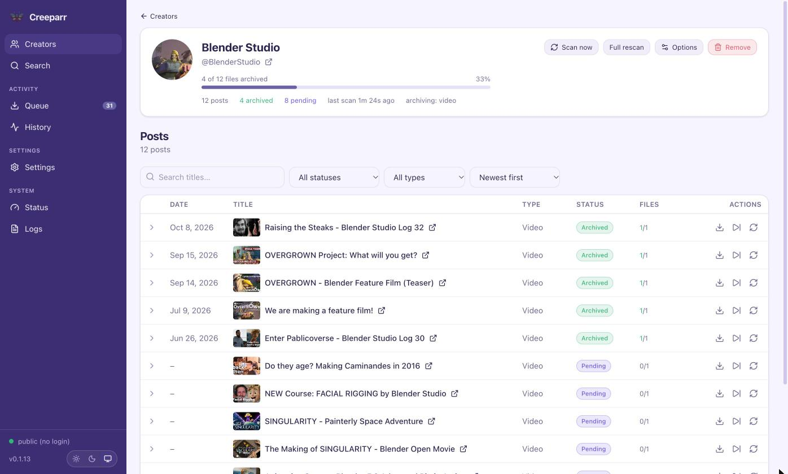
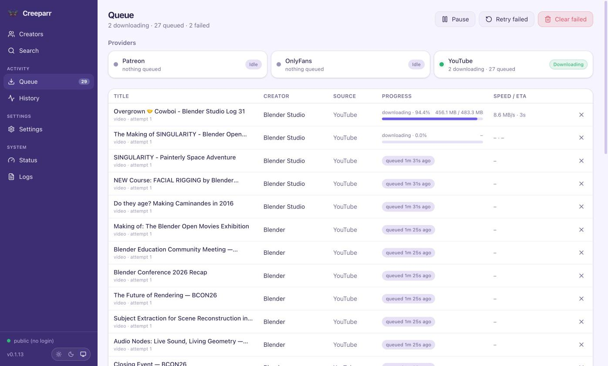
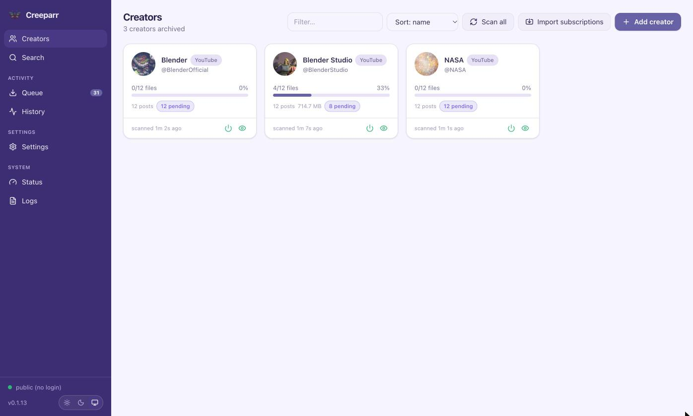
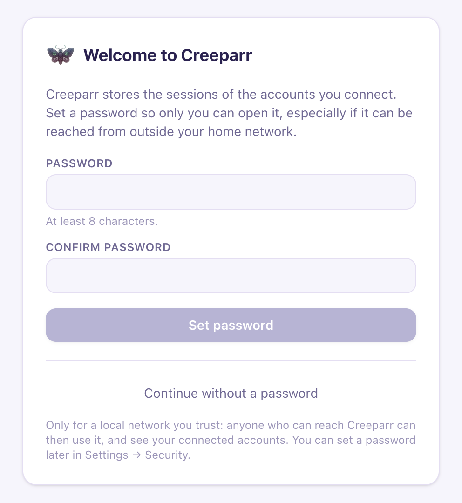

# Creeparr

A self-hosted, *arr-style archiver for the creators you follow on **Patreon, OnlyFans and
YouTube**. Add a creator, and Creeparr slowly backs up every post you have access to, then
keeps checking for new ones.



<details>
<summary>More screenshots</summary>

| | |
| --- | --- |
|  |  |
|  | |

</details>

<sub>Screenshots show openly licensed videos: Blender Studio and the Blender Foundation
(CC BY) and NASA (public domain).</sub>

- Archives video (direct files, HLS streams, YouTube / Vimeo embeds via yt-dlp), and
  optionally images, audio and attachments per creator.
- **Import your subscriptions** in one click, or add creators by URL / handle / id.
- Gentle by design: per-provider request rates and a downloads-per-hour cap spread out at
  random, over a queue of any size.
- Light/dark/auto web UI: creators grid, per-creator post list with per-file status, live
  download queue, history, settings, system status and logs.
- Scheduled incremental scans, full back-fills, retries with back-off, DRM detection,
  disk-space guard, resumable downloads, `post.json` / `post.md` / `post.html` sidecars.
- One container, SQLite, no external services. `PUID`/`PGID`/`TZ` like linuxserver images.

> Creeparr only reads content **your own account** can already see. It never bypasses
> access controls, skips DRM-protected media, and is intended for personal archival of the
> content you pay for. Do not use it to redistribute creators' work. Patreon's and
> OnlyFans' terms forbid automated access; using Creeparr is your decision and your risk.

## What's supported

| Provider  | Needs                                   | Notes                                                |
| --------- | --------------------------------------- | ---------------------------------------------------- |
| Patreon   | your `session_id` cookie                | Posts, embeds, attachments; import your memberships  |
| OnlyFans  | `sess`, `auth_id` and `x-bc` from your browser | Posts and messages; DRM videos are skipped    |
| YouTube   | nothing (cookies only for members-only) | Whole channels, via yt-dlp                           |

Instagram and Reddit were supported in earlier versions and are **switched off** for now:
both block automated access too aggressively to be usable. If you archived from them
before, those creators, posts and files are kept and left alone.

## Quick start

```yaml
# docker-compose.yml
services:
  creeparr:
    image: ghcr.io/omegadan/creeparr:latest   # the latest release; see "Releases and updates"
    container_name: creeparr
    environment:
      - PUID=99                 # Unraid defaults; use your own uid/gid elsewhere
      - PGID=100
      - TZ=America/Los_Angeles
    volumes:
      - ./config:/config
      - /mnt/media/creeparr:/downloads
    ports:
      - "7979:7979"
    restart: unless-stopped
```

```bash
docker compose up -d
open http://localhost:7979
```

On first start Creeparr asks you to **set a password**. Do, unless it only runs on a
network you trust: the accounts you connect are reachable through it (see
[Security](#security)).

Then, in **Settings**, open a provider's tab and connect it. YouTube works without an
account. For example, **Patreon**:

1. Log in to patreon.com in your browser.
2. Open DevTools → Application → Cookies → `https://www.patreon.com` and copy the value of
   the `session_id` cookie.
3. Paste it into Creeparr and click **Save & connect**. You should see your account name.
4. Go to **Creators → Import pledges** (or **Add creator**) and pick who to archive.

A full back-fill starts immediately; after that, monitored creators are re-scanned every
60 minutes (configurable). New media is queued and downloaded automatically.

### Files on disk

```
/downloads/
└── Creator Name/
    └── 2026-03-14 - Episode 12 [98765432]/
        ├── episode-12.mp4
        ├── post.json      # raw API record
        ├── post.md        # post text as Markdown with front matter
        └── post.html      # post text as HTML
```

The folder and file templates are editable in **Settings → Naming & general**, with a live
preview.

## Releases and updates

Images are published to `ghcr.io/omegadan/creeparr` for `linux/amd64` and `linux/arm64`.
The image is public; no login is needed to pull it.

| Tag             | What it is                                                      |
| --------------- | --------------------------------------------------------------- |
| `latest`        | The latest release. What the examples here and the Unraid template use. |
| `0.2`           | The latest `0.2.x` release: fixes, but no new minor version.    |
| `0.2.0`         | Exactly that release, never changes.                            |
| `edge`          | Every merge to `main`, before it's released. For testing.       |

Pin `0.2` (say) to choose when you move to the next minor version; pin an exact version to
change nothing until you do. What changed in each release is in
[CHANGELOG.md](CHANGELOG.md) and on the [Releases](https://github.com/omegadan/creeparr/releases)
page.

Sites often break yt-dlp, and fixes ship in its new releases. Creeparr checks every week;
when a yt-dlp or gallery-dl update is the only change since the last release, it's released
as a patch on its own, so `latest` and `0.2` pick it up without anyone doing anything.

## Unraid

An Unraid template is provided. Docker tab → Add Container → paste this Template URL:

```
https://raw.githubusercontent.com/omegadan/creeparr/main/unraid/creeparr.xml
```

See [unraid/README.md](unraid/README.md) for details.

## Configuration

Copy `env.example` to `.env` next to `docker-compose.yml` and edit it; Compose picks it up
automatically. `CONFIG_DIR` and `DOWNLOAD_DIR` are required; the rest have defaults.
Every variable is documented in that file. Summary:

| Variable               | Default       | Purpose                                                |
| ---------------------- | ------------- | ------------------------------------------------------ |
| `PUID` / `PGID`        | `99` / `100`  | User/group that owns files (Unraid defaults in compose; the bare image defaults to `1000`) |
| `TZ`                   | `America/Los_Angeles` | Time zone                                      |
| `CONFIG_DIR`           | required      | Host path mounted at `/config` (database, logs)        |
| `DOWNLOAD_DIR`         | required      | Host path mounted at `/downloads`: the default archive root for every provider |
| `PATREON_DOWNLOAD_DIR`, `ONLYFANS_DOWNLOAD_DIR`, `YOUTUBE_DOWNLOAD_DIR` | unset | Optional per-provider archive root; unset ones use `DOWNLOAD_DIR` |
| `PORT`                 | `7979`        | Host port for the web UI                               |
| `CREEPARR_LOG_LEVEL`   | `INFO`        | `DEBUG`, `INFO`, `WARNING`, `ERROR`                    |
| `CREEPARR_ALLOWED_HOSTS` | unset       | Extra host names allowed while no password is set (see [Security](#security)) |
| `CREEPARR_CONFIG_DIR`  | `/config`     | In-container config path (only when not using Docker) |
| `CREEPARR_DOWNLOAD_DIR`| `/downloads`  | In-container default archive path (only when not using Docker) |
| `CREEPARR_<PROVIDER>_DOWNLOAD_DIR` | unset | Per-provider archive path (`PATREON`, `ONLYFANS`, `YOUTUBE`); falls back to `CREEPARR_DOWNLOAD_DIR` |
| `CREEPARR_PORT`        | `7979`        | Port the server listens on                             |

Everything else (scan interval, concurrency, retries, naming, per-kind toggles, HTTP backend)
lives in the database and is edited in the UI. See [docs/configuration.md](docs/configuration.md).

## If Patreon blocks requests

Patreon sits behind Cloudflare. If **Test connection** reports a *Cloudflare challenge*:

1. Paste a full `cookies.txt` export (e.g. the "Get cookies.txt LOCALLY" extension) instead
   of only `session_id`; the `cf_clearance` cookie is forwarded.
2. Switch **HTTP backend** to `curl_cffi` (Chrome TLS impersonation). It is included in the
   Docker image.

## Security

On first start Creeparr asks you to set a password; it gates the whole API. If you skip
it, the sidebar shows **No password set** until you add one in **Settings → Security**.
Skip it only on a network you trust: without a password, anyone who can reach Creeparr can
use it.

Credentials you paste (Patreon/OnlyFans cookies) are stored in the SQLite database under
`/config`, **unencrypted**, and never shown back in full. They give full access to those
accounts, so keep `/config` private and out of shared backups. Logs mask them.

Two checks stop other websites from using the API through your browser:

- State-changing API calls (`POST`/`PUT`/`PATCH`/`DELETE`) must send an
  `X-Requested-With` header (any value). The web UI does; add it to your own scripts,
  e.g. `curl -X POST -H 'X-Requested-With: curl' http://tower:7979/api/v1/creators/scan-all`.
- While no password is set, the UI only answers to IP addresses, bare host names
  (`tower`), `localhost` and `.local` / `.lan` / `.home.arpa` / `.internal` / `.ts.net`
  names. To open it by another name (a reverse-proxy domain, say), set a password or
  list the name in `CREEPARR_ALLOWED_HOSTS`.

## Status

Early, and changing. It's covered by unit and integration tests against recorded API
responses, but the [end-to-end checklist](docs/e2e-checklist.md) against real accounts
hasn't been run yet. The Patreon and OnlyFans APIs are private and can change without
notice; when one does, expect a broken scan until a release fixes it.

## Development

```bash
# backend (Python 3.12, uv)
cd backend && uv sync --all-extras   # plain `uv sync` removes curl_cffi (the `impersonate` extra the image ships)
CREEPARR_CONFIG_DIR=../config CREEPARR_DOWNLOAD_DIR=../downloads \
  uv run uvicorn creeparr.app:create_app --factory --reload --port 7979
uv run pytest -q && uv run ruff check .

# frontend (Node 22)
cd frontend && npm ci && npm run dev     # proxies /api to :7979
npm run build                            # output in frontend/dist

make build   # builds the UI and copies it into backend/creeparr/static
make docker  # builds the image
```

The Docker image is about 720 MB unpacked (Python, yt-dlp, gallery-dl, deno, static ffmpeg).
Layout: `backend/creeparr/{providers,patreon,scanner,downloader,api,core,db}` and
`frontend/src/{pages,components,api}`. Architecture notes in [docs/architecture.md](docs/architecture.md);
what was verified about Patreon's private API in [docs/patreon-api.md](docs/patreon-api.md);
manual test plan in [docs/e2e-checklist.md](docs/e2e-checklist.md).

To release: add a line under **Unreleased** in [CHANGELOG.md](CHANGELOG.md) with each
change people will notice. When it's time, run the **Release** workflow from the Actions
tab (patch, minor or major); it bumps the version in `backend/creeparr/__init__.py`, tags
it, publishes the image and writes the GitHub Release from the changelog.

## License

MIT
